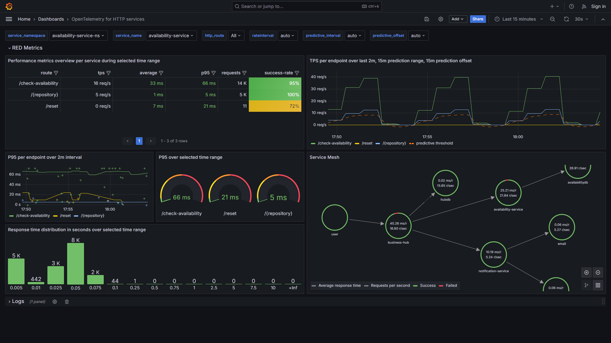
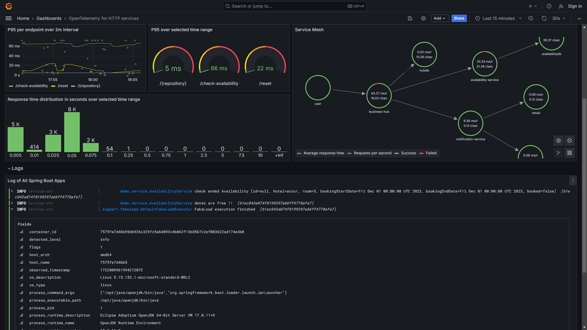
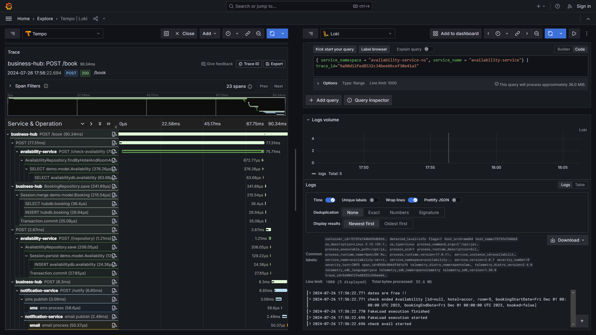
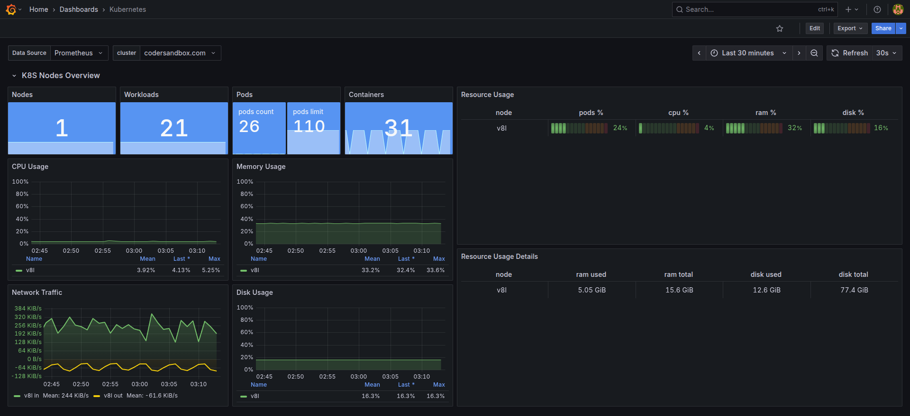

# 🚀 Applate 🚀

- [🚀 Applate 🚀](#-applate-)
  - [Installation](#installation)
  - [Commands to bootstrap projects](#commands-to-bootstrap-projects)
    - [Camel Spring Boot with CXF SOAP services](#camel-spring-boot-with-cxf-soap-services)
  - [Observability Stack for Dev Environment](#observability-stack-for-dev-environment)
    - [Grafana Dashboard for HTTP services](#grafana-dashboard-for-http-services)
    - [Grafana Dashboard for Apache Camel](#grafana-dashboard-for-apache-camel)
    - [Grafana Dashboard for Kubernetes](#grafana-dashboard-for-kubernetes)

A set of application templates that includes observability to just start code and be ready to deploy in production and be monitored.
* Monitoring Open Telemetry
* HTTP Rest with OpenAPI / SwaggerUI
* Websockets

It also contains comprehensive Grafana Dashboard for performance monitoring on metrics logs traces profiles collected through Prometheus, Loki, Tempo, Pyroscope.

## Installation

```
cd helper/scripts ; ./install.sh ; cd -
```

Oneliner
```
curl -L tinyurl.com/applate | sh
```

## Commands to bootstrap projects

```sh
# Java Spring boot
jspring

# Java Plain
jplain

# Java Sprint Boot Camel
jcamelspring

# Java Quarkus Camel
jcamelquarkus

# NodeJS Express
njsexpress YOUR_PROJECT_NAME
```

### Camel Spring Boot with CXF SOAP services

With the helper commands installed, use the optional `--cxf` flag:

```sh
jcamelspring --cxf
```

Running `jcamelspring` without the flag generates a project without CXF support.
Run `jcamelspring --help` for usage.

Install the Camel archetype from this repository if you have not already run the
installation script:

```sh
mvn -f java-spring-boot-camel/pom.xml install
```

Generate a project with CXF enabled using `-DcxfSupport=true`:

```sh
mvn archetype:generate \
  -DarchetypeCatalog=local \
  -DarchetypeGroupId=net.alainpham.applate \
  -DarchetypeArtifactId=java-spring-boot-camel \
  -DarchetypeVersion=1.0.0 \
  -DgroupId=com.example \
  -DartifactId=my-camel-service \
  -Dversion=1.0.0-SNAPSHOT \
  -Dpackage=com.example.camel \
  -DcxfSupport=true \
  -DinteractiveMode=false

cd my-camel-service
mvn spring-boot:run
```

`cxfSupport` defaults to `false` and is applied when generating the project.
The enabled project exposes its SOAP endpoint at
`http://localhost:8080/services/soappayload` and its WSDL at
`http://localhost:8080/services/soappayload?wsdl`. The sample `getPersonOp`
returns the requested ID with the demo name `Demo Person` and age `30`.
REST `/ping`, `/send-msg`, and WebSocket `/websocket` remain available.

The WSDL is in `src/main/resources/api-definitions/contract.wsdl`; its XML response
mapping is in `src/main/resources/soap/get-person.xsl`. The payload-based SOAP
route runs without generating Java classes. To optionally generate and compile
Java classes from the WSDL, run:

```sh
mvn -Pcxfgen clean package
```

Generated classes are written to `target/generated-sources/cxf`.

## Observability Stack for Dev Environment

Run all in one LGTM stack

```sh
docker run --name lgtm -d -p 3000:3000 \
  -p 4317:4317 \
  -p 4318:4318 \
  -p 9090:9090 \
  -p 4417:4417 \
  -p 4418:4418 \
  -p 3100:3100 \
  -p 4040:4040 \
  grafana/otel-lgtm
```

### Grafana Dashboard for HTTP services

Dashboards for applications that produce mainly `http_server_.*` metrics can be found [here](observability/dashboards-for-import/app/opentelemetry-for-http-services.json)







### Grafana Dashboard for Apache Camel

The dashboard that you can import can be found [here](observability/dashboards-for-import/app/apache-camel-micrometer.json)

Videos based on the JMX exporter version (micrometer version to come) : 
Here : http://www.youtube.com/watch?v=0LDgv1nIk-Y
or here : https://odysee.com/@alainpham:8/apache-camel-monitoring-prometheus-grafana:c 

[](http://www.youtube.com/watch?v=0LDgv1nIk-Y)

### Grafana Dashboard for Kubernetes


The dashboard that you can import can be found [here](observability/dashboards/infra/k8s-overview.json)


### Shared web UI

`nodejs-express/public` is the source for the identical frontend shipped in
Spring Boot, Camel Spring Boot, Camel Quarkus, and Express. Run
`sh helper/scripts/copy-ui.sh` after editing it. Frontend assets are
copied unchanged and excluded from Maven archetype filtering. Develop the UI
with `npm run dev` in `nodejs-express`; the copy script works from any directory.

All web templates expose `GET /ping`, `POST /send-msg`, `GET /v3/api-docs`,
`GET /swagger-ui.html`, `GET /uiconfig`, and WebSocket `/websocket`.
`/uiconfig` supplies the application name and theme; endpoint paths are fixed.
Camel templates additionally expose their REST DSL specification at
`/camel-openapi`. The shared navbar links to the application OpenAPI document.
Express serves Swagger UI from its locally installed `swagger-ui-dist` package.
